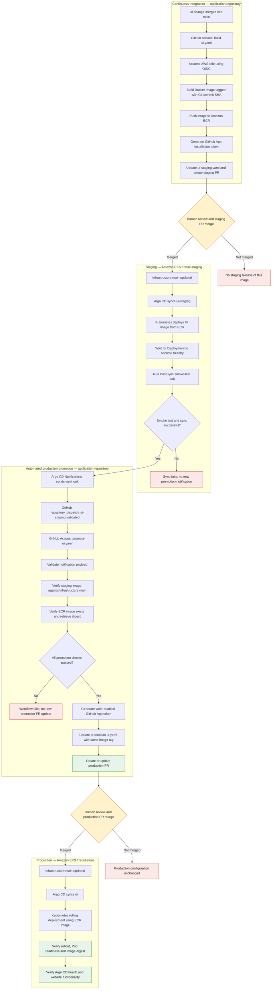

# UI CI/CD Pipeline — NTU Cloud Infrastructure Engineering Capstone

**Project:** Group 2 Retail Store Sample Application  
**Scope:** UI service, staging validation and production promotion  
**As of:** 28 November 2026 (Singapore time)  
**Platform:** GitHub Actions, Amazon ECR, Amazon EKS and Argo CD

## 1. Objective

Implement a GitOps-based continuous integration and continuous delivery (CI/CD) pipeline that builds a UI container image once, deploys it to staging, runs an automated smoke test and creates a production promotion pull request (PR) only when staging validation succeeds. Production deployment requires a human to review and merge the production PR. The promotion workflow reuses the image reference instead of rebuilding the image.

## 2. End-to-end flow



> Mermaid renders as a flowchart in GitHub and compatible Markdown viewers. The numbered stages below also describe the same flow in plain text.

## 3. Repository and environment layout

| Component | Configuration |
| --- | --- |
| Application repository | [cloud-ntu-capstone-group2-app](https://github.com/eugenewongyj/cloud-ntu-capstone-group2-app) |
| Infrastructure repository | [cloud-ntu-capstone-group2-infra](https://github.com/eugenewongyj/cloud-ntu-capstone-group2-infra) |
| AWS region | `ap-southeast-1` |
| Amazon EKS cluster | `group2-capstone-cluster` |
| Amazon ECR repository | `255945442255.dkr.ecr.ap-southeast-1.amazonaws.com/group2-capstone-ui` |
| Staging namespace | `retail-staging` |
| Staging Argo CD Application | `ui-staging` |
| Production namespace | `retail-store` |
| Production Argo CD Application | `ui` |
| Helm chart | `src/ui/chart` in the application repository, release name `ui` |
| Staging automation branch | `automation/ui-staging` |
| Production automation branch | `automation/ui-production` |

Both environments run in the same EKS cluster, with separate namespaces and workload node pools. Argo CD Application definitions reside in the infrastructure repository; the Helm chart resides in the application repository. Both applications currently reference the chart at `targetRevision: main`.

## 4. Detailed implementation flow

### Stage 1 — Build and publish the UI image

**Workflow:** [`.github/workflows/build-ui.yaml`](https://github.com/eugenewongyj/cloud-ntu-capstone-group2-app/blob/main/.github/workflows/build-ui.yaml)

1. A change under `src/ui/**` is pushed or merged into the application repository's `main` branch. A manual `workflow_dispatch` is also supported, with jobs restricted to `main`.
2. GitHub Actions checks out the application code and obtains short-lived AWS credentials using OpenID Connect (OIDC) to assume an AWS Identity and Access Management (IAM) role.
3. The workflow authenticates to Amazon Elastic Container Registry (ECR).
4. Docker builds the UI image from `src/ui/Dockerfile`, using `src/ui` as the build context.
5. The image is tagged with `${{ github.sha }}` and pushed to ECR.

**Output:** `group2-capstone-ui:<application-commit-sha>` in ECR.

### Stage 2 — Create staging deployment PR

The `update-staging` job runs only after the build job succeeds.

1. Generate a short-lived GitHub App installation token scoped to the infrastructure repository, with contents and pull request write permissions.
2. Check out infrastructure `main`.
3. Update `spec.source.helm.valuesObject.image.tag` in [gitops/app-staging/apps/ui-staging.yaml](https://github.com/eugenewongyj/cloud-ntu-capstone-group2-infra/blob/main/gitops/app-staging/apps/ui-staging.yaml), using `ruamel.yaml`.
4. Use `peter-evans/create-pull-request` to create or update a PR from `automation/ui-staging` into `main`.
5. A human reviews and merges the staging PR.

**Output:** The desired staging image changes in the infrastructure repository. No direct `kubectl` deployment is performed by this workflow.

### Stage 3 — Deploy to staging through Argo CD

1. The parent Argo CD Application (`root-app-staging`) reconciles the staging Application definition from infrastructure Git.
2. `ui-staging` synchronizes the UI Helm chart and image configuration into `retail-staging`.
3. Kubernetes rolls out the UI Deployment, and the Pods pull the configured image from ECR as needed.
4. Argo CD waits for the application's resources to become healthy before executing the PostSync hook.

### Stage 4 — Automated staging smoke test

**Hook:** [`src/ui/chart/templates/smoke-test-job.yaml`](https://github.com/eugenewongyj/cloud-ntu-capstone-group2-app/blob/main/src/ui/chart/templates/smoke-test-job.yaml)

| Setting | Value |
| --- | --- |
| Kubernetes resource | `batch/v1` Job, `ui-smoke-test` |
| Execution phase | Argo CD `PostSync` |
| Hook deletion policy | `BeforeHookCreation` |
| Test container | `curlimages/curl:8.23.0` |
| Default endpoint | `http://ui:80/actuator/health/readiness` |
| Passing result | HTTP 200 |
| Job backoff limit | `0` (no replacement Pod retries) |
| Job active deadline | 180 seconds |
| Scope | Enabled in staging only; template also checks namespace `retail-staging` |

The Job runs as a non-root user, disables automatic ServiceAccount token mounting, uses a read-only root filesystem, drops all Linux capabilities and disallows privilege escalation. The curl command itself supports retries for applicable transient errors.

- **Success:** The Job succeeds and Argo CD records a successful synchronization.
- **Failure:** The Job fails and Argo CD records a failed synchronization. No new production promotion notification is triggered by that failed operation.

This is a basic readiness smoke test, not comprehensive UI functional, integration or security testing. The expected image reference is logged by the Job, but the Job does not independently verify the running staging image digest.

### Stage 5 — Argo CD Notifications triggers promotion

**Configuration:** [gitops/infra/apps/argocd.yaml](https://github.com/eugenewongyj/cloud-ntu-capstone-group2-infra/blob/main/gitops/infra/apps/argocd.yaml)

The staging Application subscribes to the custom notification trigger:

```yaml
metadata:
  annotations:
    notifications.argoproj.io/subscribe.on-ui-staging-validated.github-dispatch: ""
```

Trigger `on-ui-staging-validated` evaluates the following conditions:

- Application name is `ui-staging` and destination namespace is `retail-staging`.
- Synchronization operation phase is `Succeeded`.
- The synchronization result contains a successful `ui-smoke-test` Job in the `PostSync` phase.
- The image repository matches the expected ECR repository, and its tag is a 40-character lowercase hexadecimal Git SHA.

`oncePer: app.status.operationState.finishedAt` suppresses repeat notifications for the same synchronization completion timestamp under normal operation.

The `github-dispatch` webhook sends an HTTP POST to the GitHub repository dispatch endpoint:

```text
POST https://api.github.com/repos/eugenewongyj/cloud-ntu-capstone-group2-app/dispatches
```

Example payload (illustrative placeholders):

```json
{
  "event_type": "ui-staging-validated",
  "client_payload": {
    "application": "ui-staging",
    "namespace": "retail-staging",
    "image_repository": "255945442255.dkr.ecr.ap-southeast-1.amazonaws.com/group2-capstone-ui",
    "image_tag": "<application-image-commit-sha>",
    "chart_revision": "<synchronized-helm-chart-commit-sha>",
    "sync_finished_at": "<UTC-timestamp>",
    "sync_phase": "Succeeded"
  }
}
```

The webhook authenticates with a fine-grained GitHub Personal Access Token (PAT). The token is stored in AWS Secrets Manager and synchronized by External Secrets Operator (ESO) into `argocd-notifications-secret`, using `github-dispatch-token` as the key. No token value is committed to Git.

### Stage 6 — Validate and create production promotion PR

**Workflow:** [`.github/workflows/promote-ui.yaml`](https://github.com/eugenewongyj/cloud-ntu-capstone-group2-app/blob/main/.github/workflows/promote-ui.yaml)

```yaml
on:
  repository_dispatch:
    types:
      - ui-staging-validated
```

| Step | Purpose |
| --- | --- |
| Validate notification payload | Verify expected application, namespace, success phase, ECR repository, image and chart SHA formats, and parseable timestamp. |
| Generate read-only GitHub App token | Obtain access to read the infrastructure repository. |
| Check out infrastructure `main` | Retrieve the current desired staging and production configuration. |
| Verify staging image against Git | Reject an event if the reported image repository or tag differs from the staging manifest in the checked-out commit. |
| Configure AWS credentials | Assume the AWS role via OIDC; restrict the promotion session with an inline policy for `ecr:BatchGetImage` on the UI repository. |
| Verify ECR artifact | Use `aws ecr batch-get-image` to confirm the image exists and record its SHA-256 digest. |
| Generate write-enabled GitHub App token | Obtain contents and PR write permissions for the infrastructure repository. |
| Update production image tag | Modify [gitops/app/apps/ui.yaml](https://github.com/eugenewongyj/cloud-ntu-capstone-group2-infra/blob/main/gitops/app/apps/ui.yaml) with the same image tag. Avoid rewriting the manifest if the tag already matches. |
| Create or update production PR | Open or update a PR using the fixed `automation/ui-production` branch. Include image reference, ECR digest, tested chart revision and sync completion time in the PR body. |

If a validation step fails, subsequent PR creation steps do not run. The fixed automation branch allows reuse of an open promotion PR rather than creating a new PR for every notification.

**Output:** A production deployment request in the infrastructure repository. The current workflow creates draft PRs (`draft: true`); changing this to `false` has been recommended but is not yet implemented.

### Stage 7 — Manual production approval and GitOps deployment

1. Mark the production PR ready for review if it is a draft.
2. Review the proposed image update and latest staging validation evidence; satisfy the repository's required reviews and checks.
3. Merge the production PR into infrastructure `main`.
4. Argo CD reconciles the production `ui` Application and deploys the image into `retail-store`.
5. Verify the rolling deployment, running Pod readiness and actual container image identities.
6. Confirm the Argo CD Application is `Synced` and `Healthy`, and verify the website's functionality.

The production workflow does not rebuild the Docker image or directly deploy into Kubernetes. This is continuous delivery with a human-controlled production release, rather than fully automatic continuous deployment to production.

## 5. End-to-end validation results

The test timestamps below use UTC on 27 November 2026 (early morning on 28 November in Singapore).

| Test | Observed result | Status |
| --- | --- | --- |
| Automatic subscription | Existing successful sync triggered [promotion run](https://github.com/eugenewongyj/cloud-ntu-capstone-group2-app/actions/runs/46063674672) at 20:26:42 UTC. | Passed |
| Positive end-to-end test | Fresh staging sync succeeded at 20:39:50; [promotion run](https://github.com/eugenewongyj/cloud-ntu-capstone-group2-app/actions/runs/46065158724) started at 20:39:52 and succeeded. [PR #380](https://github.com/eugenewongyj/cloud-ntu-capstone-group2-infra/pull/380) updated at 20:40:12. | Passed |
| Negative smoke test | Temporary path `/actuator/health/nonexistent-test-endpoint` returned HTTP 404. PostSync Job and sync failed at 20:46:24; no new promotion workflow was observed and PR #380 remained unchanged. | Passed |
| Recovery | Removed the temporary path override; sync and PostSync Job succeeded at 20:49:52. [Promotion workflow](https://github.com/eugenewongyj/cloud-ntu-capstone-group2-app/actions/runs/46066279312) triggered at 20:49:57. | Automatic recovery confirmed; workflow was in progress at last direct check |
| Production release | PR #380 merged per operator report; Argo CD synced the intended image. Kubernetes rollout succeeded and all six reported UI Pods were ready. | Rollout and image verification passed |
| Final application health and website checks | Last explicitly reported Argo CD health was `Progressing` before rollout finished; final `Healthy` status and website functionality were not separately reported. | Not yet documented |

### Example promoted artifact

```text
Previous production image tag:
ff62127ef2e7ac354501f8807690567bb30825a3

New staging and production image tag:
72a5644da135f24eeb5f3ec462506c4f458bde50

ECR image digest recorded in production PR #380 and observed on all six production UI Pods:
sha256:82a6320a45abf960614f5061779486ad884c3189f27485baccf543e3bd48261c
```

The production runtime digest matched the ECR digest recorded during promotion. Staging runtime digest was not captured independently during the smoke test, so this does not by itself prove staging and production executed identical image bytes. Tags are currently mutable.

### Production autoscaling observation

The UI Horizontal Pod Autoscaler (HPA) is configured for a minimum of 2 and maximum of 6 replicas, targeting average CPU utilization of 70% of CPU requests. HPA events confirmed scaling to 4 and then 6 replicas because CPU utilization exceeded the target. It subsequently reported 4% CPU utilization with scale-down stabilization active. This is separate from the promotion workflow; the pipeline does not explicitly request six replicas.

## 6. Useful verification commands

### Staging operation and smoke test

```bash
kubectl get application ui-staging -n argocd -o json \
  | jq '.status.operationState | {
      phase,
      message,
      startedAt,
      finishedAt,
      image: .syncResult.source.helm.valuesObject.image,
      smokeTest: [
        .syncResult.resources[]? |
        select(.kind == "Job" and .name == "ui-smoke-test")
      ]
    }'

kubectl logs job/ui-smoke-test -n retail-staging
```

### Production rollout and runtime image

```bash
argocd app get ui
kubectl rollout status deployment/ui -n retail-store

kubectl get pods -n retail-store \
  -l app.kubernetes.io/name=ui -o json \
  | jq '.items[] | {
      name: .metadata.name,
      containers: [
        .status.containerStatuses[]? |
        select(.name == "ui") |
        {ready, image, imageID}
      ]
    }'

kubectl describe hpa ui -n retail-store
```

Avoid printing unfiltered Argo CD notification debug logs or secret values, as the webhook Authorization header may contain the PAT.

## 7. DevSecOps practices and outstanding improvements

### Implemented practices

- GitOps with declarative configuration, Git history and manual release gates.
- Build once and promote the same image reference across environments.
- Short-lived AWS credentials through OIDC and GitHub App installation tokens for cross-repository automation.
- Centralized storage of the webhook PAT using AWS Secrets Manager and ESO.
- Automated staging smoke testing, success-gated promotion and ECR artifact verification.
- Fixed automation PR branches and staging manifest verification to reduce redundant or stale promotion requests.
- Positive, negative and recovery testing, plus production rollout and runtime digest verification.

### Deferred or incomplete improvements

| Item | Current limitation / next improvement |
| --- | --- |
| 6E — ECR image immutability | Enable immutable tags and consider digest-pinned deployment. A mutable tag can be overwritten; ECR retention may also remove artifacts. |
| 6F — Helm chart revision consistency | The chart tracks `main`, so the chart version can change between staging validation and production deployment. Pin the tested revision or adopt versioned chart artifacts. |
| 6H — Additional stale and duplicate safeguards | Add concurrency control, timestamp freshness validation and a fresh Git verification before PR creation if needed. Current Git verification is a point-in-time check. |
| Merge-time validation | Failed staging tests do not automatically close or block an already-open production PR. Reviewers must confirm the intended release is still valid. |
| Notification sender trust | Promotion trusts the Argo CD report; another authorized sender could dispatch a fabricated event. Replace the fine-grained PAT with a dedicated GitHub App or strengthen event authentication in a later iteration. |
| CI permissions | Review and remove legacy direct Kubernetes access from the CI role once legacy deployment workflows are retired. |
| Draft production PRs | `draft: true` remains configured; consider setting it to `false` once final testing is complete, while retaining human review and merge controls. |
| Workflow path filter | `build-ui.yaml` currently filters `.github/workflows/build-ui.yml` (different extension); align this path if changes to the workflow file itself should trigger a build. UI source changes already trigger the build. |
| Test coverage | Add pre-merge testing and broader functional/security validation as appropriate. This document covers the implemented UI release pipeline, not every DevSecOps check or service. |

## 8. Summary

The implemented UI CI/CD pipeline automates image building, staging PR generation, GitOps staging deployment, smoke testing, notification-driven promotion and production PR generation. Both staging and production releases retain human-controlled merges. The positive and negative tests demonstrate that a successful staging validation initiates promotion and a failed validation does not create a new promotion request. Production rollout and runtime image verification have succeeded for the tested release, with final website and application health checks still to be documented.
