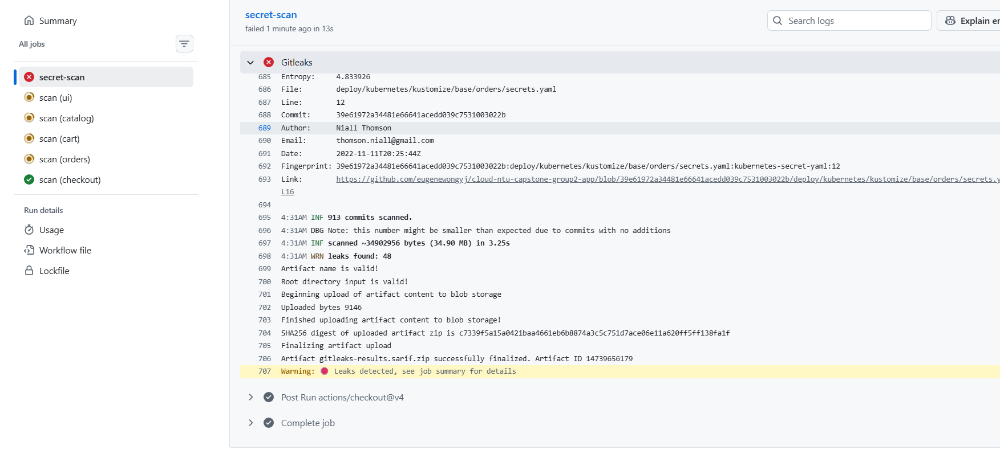
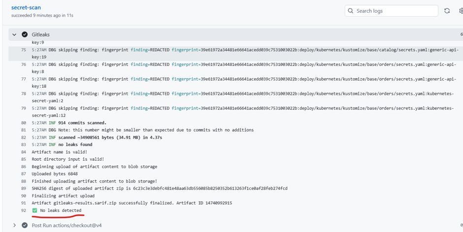
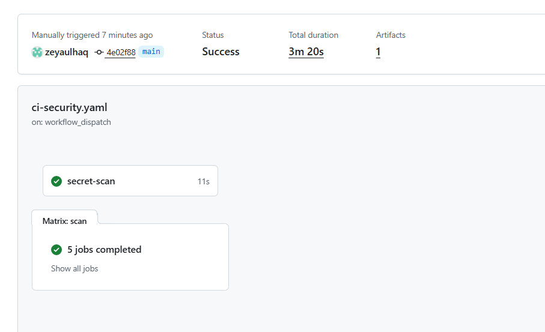
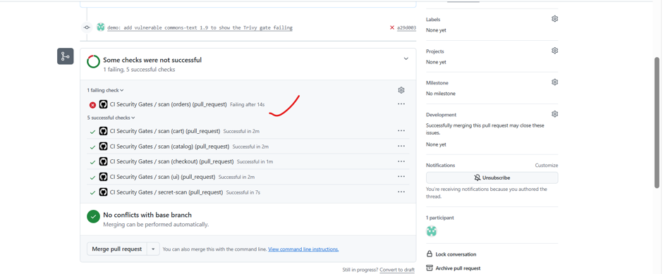
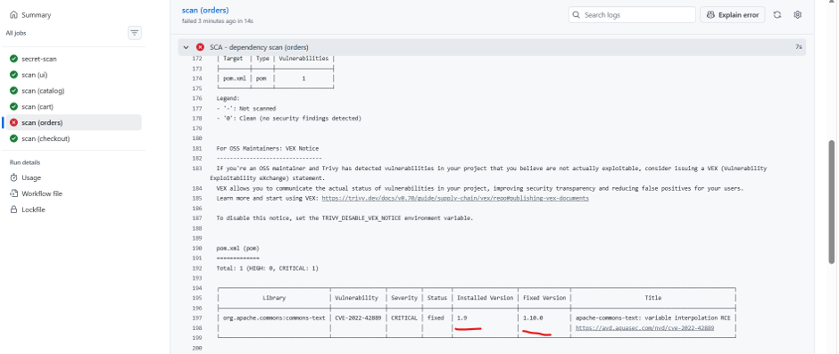
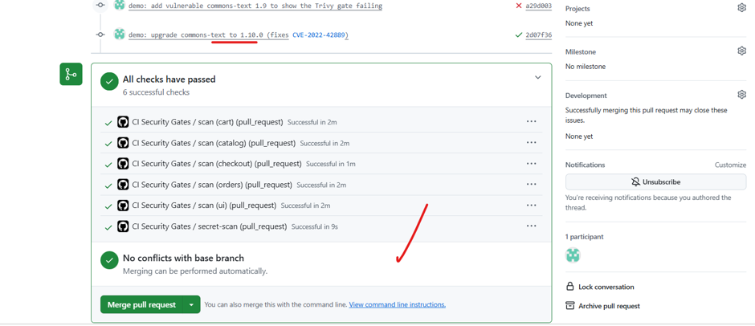

# CI security gates: how a failed gate is handled

Every pull request to `main` runs the **CI Security Gates** workflow
([`.github/workflows/ci-security.yaml`](../.github/workflows/ci-security.yaml)).
A PR with a failing gate shows a red check and must not be merged until the
finding is fixed, or formally accepted with an owner, a reason and an expiry date.

## The gates

| Gate | Tool | Scans | Fails the PR when |
| --- | --- | --- | --- |
| 1. Secret scan | Gitleaks | Commits in the PR (full history on a manual run) | Any password, key or token is found |
| 2. Dependency scan (SCA) | Trivy `fs` | `src/<service>` for ui, catalog, cart, orders, checkout | A **HIGH or CRITICAL** vulnerability that has a fix |
| 3. Image scan | Trivy `image` | The container image built from each service | A **HIGH or CRITICAL** vulnerability that has a fix |

The threshold is enforced with `exit-code: "1"` on every Trivy step. It is never
set to `0`, so a finding always fails the job instead of only printing a warning.

## What we do when a gate fails

1. **Detect.** The PR check goes red; the job log lists each finding (file or library, CVE, severity, fixed version).
2. **Triage.** Decide whether the finding is real and exploitable in our deployment.
3. **Fix (default).** Upgrade the library or remove the secret, push again, and the gate re-runs.
4. **Accept (exception only).** If no fix is possible or the finding does not apply, record it in a risk register
   with a reason, evidence, an approver and an expiry date:
   - [`.trivyignore`](../.trivyignore) for vulnerabilities (entries expire, then the gate fails again)
   - [`.gitleaksignore`](../.gitleaksignore) for secret-scan findings (exact fingerprints only)
5. **Review.** The fix or the exception goes through a PR with at least one reviewer.

Two real examples follow: one found by the secret-scan gate, one a controlled demo of the dependency gate.

---

## Example 1 (real finding): Gitleaks found 48 secrets in git history

**Detect.** A manual run of the gates on `main` (scanning all 913 commits) failed: `leaks found: 48`.
Pull requests had passed because a PR scan only checks the PR's own commits.

**Triage.** All 48 findings are in commits inherited from the upstream AWS sample application
(authors: upstream maintainers and their release bot, 2022 to 2025):

| Files | Findings | What they are |
| --- | --- | --- |
| `dist/kubernetes/deploy.yaml` | 39 | Sample placeholder database passwords for the upstream local demo |
| `deploy/kubernetes/kustomize/**/secrets.yaml` | 9 | Same, as Kubernetes Secret manifests |

- None of these files exist in the current code; we never deploy them.
- None were used for our AWS resources. Our real orders database password is generated by AWS in
  Secrets Manager and synced into Kubernetes by External Secrets, so it never appears in Git.

**Decision: accept, narrowly.** We added [`.gitleaksignore`](../.gitleaksignore) listing those **48 exact
fingerprints** (commit + file + rule + line), with the triage notes and approver at the top
(PR #11). We did not ignore whole folders: a new secret, in any file or path, still fails the gate.

**Result.** The full-history scan now passes, and the log shows each historical finding being skipped.

All gates on `main` are green:

---

## Example 2 (controlled demo): the dependency gate blocks a CRITICAL CVE

To show the dependency gate working, PR #12 deliberately added `org.apache.commons:commons-text`
**1.9** to the orders service. Version 1.9 has **CVE-2022-42889** ("Text4Shell"), rated **CRITICAL**.

**Detect.** The `scan (orders)` check failed; the other services and the secret scan passed.

Trivy's report names the library, the CVE, the severity and the version that fixes it:

**Fix.** We upgraded to the fixed version **1.10.0** and pushed again.

**Result.** The same PR re-ran and every check passed. The two commits (vulnerable, then fixed) show the
full before and after.

The demo PR was closed without merging.

---

## Keeping exceptions honest

- Every `.trivyignore` entry has an expiry date (`exp:YYYY-MM-DD`). When it passes, the gate fails again and the
  exception must be reviewed. The current Spring Framework entries expire on **30 Nov 2026**.
- `.gitleaksignore` holds historical fingerprints only. New findings are never added without triage and a PR review.
- The Trivy action is pinned by commit SHA in the workflow, so the scanner cannot change behaviour silently.
